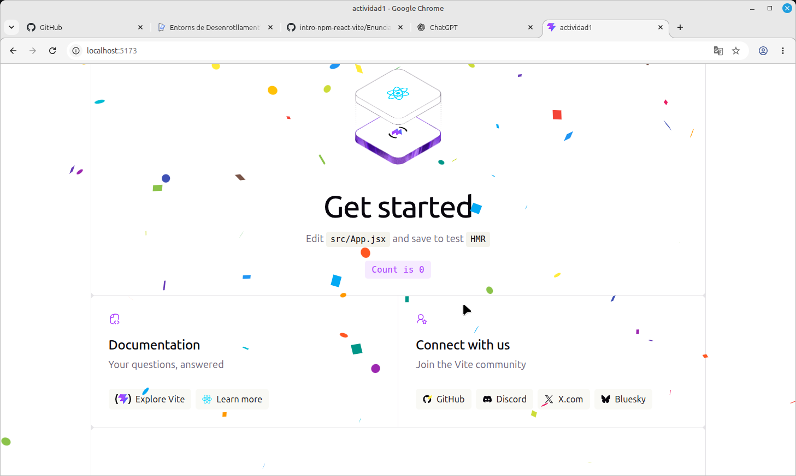
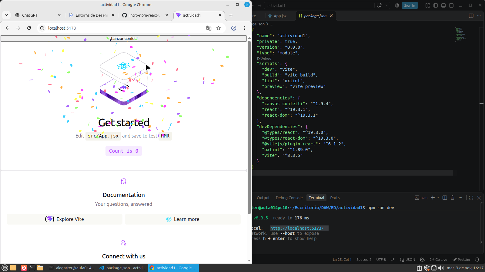

# Actividad: React, Vite y Git

## Descripción
Proyecto realizado con React y Vite para practicar el uso de dependencias, componentes, ramas y merges con Git.

---

## Capturas de pantalla

### 1. React Confetti
*(Pegar aquí la captura de la rama `react-confetti`)*

### 2. Canvas Confetti
*(Pegar aquí la captura de la rama `canvas-confetti`)*

### 3. Escena 3D
*(Pegar aquí la captura de la escena 3D de la rama `three`)*

---

## Pregunta

**Si la carpeta `node_modules/` está excluida, ¿borrar una dependencia hace alguna acción sobre el repositorio? ¿Cuál?**

Sí. Aunque la carpeta `node_modules` esté excluida del repositorio (mediante el archivo `.gitignore`), al eliminar una dependencia se modifican los archivos `package.json` y `package-lock.json`. 

Estos archivos sí están incluidos en el repositorio, por lo que Git detecta los cambios realizados y permite guardarlos mediante un commit.

---

## Web desplegada

* **Enlace:** [Ver sitio desplegado en GitHub Pages](https://alex-g-lab.github.io/Actividad-npm-react-git/)